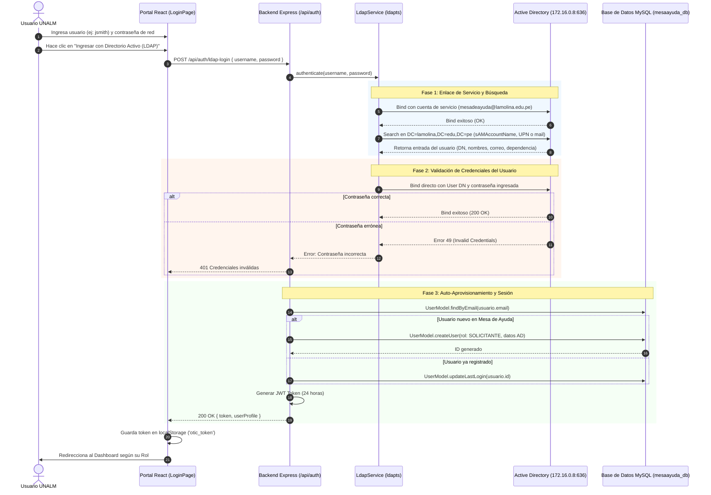

# 🔐 GUÍA TÉCNICA DE INTEGRACIÓN CON DIRECTORIO ACTIVO (LDAP / ACTIVE DIRECTORY)
## Sistema de Mesa de Ayuda OTIC - Universidad Nacional Agraria La Molina
**Versión del Sistema:** v2.5.0  
**Fecha de Despliegue:** 15 de Octubre de 2026  
**Responsable Técnico:** OTIC UNALM  

---

## 1. 📌 Resumen Ejecutivo de la Característica

A partir de la versión **v2.5.0**, el Sistema de Mesa de Ayuda de la UNALM incorpora autenticación corporativa centralizada mediante **Active Directory / LDAP**.

Esta integración permite a toda la comunidad universitaria (docentes, administrativos, autoridades y alumnos) iniciar sesión en la Mesa de Ayuda utilizando su **mismo usuario y contraseña de red institucional** del dominio `@lamolina.edu.pe` (las mismas credenciales utilizadas para iniciar sesión en equipos de cómputo del campus y servicios de red), eliminando la necesidad de recordar contraseñas separadas.

### ✨ Nuevas Características en la Versión v2.5.0:
1. **Doble Método de Acceso en Pantalla de Login:**
   - **Acceso con Cuenta Local:** Para cuentas locales de soporte, mantenimiento o cuentas de contingencia.
   - **Acceso con Directorio Activo (LDAP):** Botón institucional con validación directa contra el Controlador de Dominio de la UNALM.
2. **Auto-Aprovisionamiento Dinámico de Usuarios (Just-In-Time Provisioning):**
   - Cuando un usuario institucional inicia sesión por primera vez con sus credenciales de red, el sistema lo crea automáticamente en la base de datos de la Mesa de Ayuda con rol institucional de **SOLICITANTE** (Rol ID 4), vinculando su nombre completo, correo institucional, facultad/dependencia y cargo extraídos de Active Directory.
3. **Soporte Protocolar Resiliente (LDAPS Puerto 636 + Fallback 389):**
   - Conexión cifrada de alta seguridad compatible con las directivas de seguridad corporativas de Windows Server (LDAP Signing / Channel Binding).
4. **Modal Interactivo de Diagnóstico y Parámetros de Red:**
   - Enlace visible en el Login que permite consultar el estado del enlace LDAP en tiempo real y copiar la ficha técnica de red al portapapeles con un solo clic.

---

## 2. 🌐 Parámetros Técnicos Reales de Producción

Los siguientes parámetros fueron proporcionados por el Administrador de Redes de la UNALM y validados en el entorno de producción:

| Parámetro | Valor de Producción | Descripción |
| :--- | :--- | :--- |
| **Servidor Mesa de Ayuda** | `172.16.20.49` | Host donde residen los contenedores de la aplicación |
| **Domain Controller (DC)** | `172.16.0.8` (`unalm.lamolina.edu.pe`) | Servidor primario de Directorio Activo de la UNALM |
| **Dominio Institucional** | `lamolina.edu.pe` | Dominio corporativo de la universidad |
| **Protocolo y Puerto Activo** | **LDAPS (SSL) / Puerto 636** | Canal seguro cifrado requerido por directiva de Windows Server |
| **Puerto Estándar Alternativo** | LDAP / Puerto 389 | Puerto LDAP estándar con fallback automático |
| **Base DN de Búsqueda** | `DC=lamolina,DC=edu,DC=pe` | Raíz del árbol de búsqueda para todos los usuarios |
| **Cuenta de Servicio (Bind User)** | `mesadeayuda@lamolina.edu.pe` (o `mesadeayuda`) | Cuenta de servicio con permisos de lectura en Active Directory |
| **Contraseña de Servicio** | `@Unalm%2026#` | Contraseña asignada a la cuenta de servicio |
| **DN Oficial de la Cuenta** | `CN=Mesa de Ayuda OTIC,OU=Unidad de Tecnología y Operaciones,OU=Oficina de Tecnología de Información y Comunicaciones,OU=Rectorado,OU=UNALM,DC=lamolina,DC=edu,DC=pe` | Identificador canónico en el árbol Active Directory |
| **Timeout de Conexión** | `6000 ms` (6 segundos) | Tiempo límite para evitar bloqueos por latencia de red |

> [!IMPORTANT]
> **Nota sobre el Puerto 389 vs 636:**  
> Por defecto, Microsoft Active Directory en Windows Server tiene activada la directiva de seguridad que rechaza inicios de sesión sin integridad criptográfica en el puerto 389 (`DSID-0C09035A: The server requires binds to turn on integrity checking if SSL\TLS are not already active`).  
> Por ello, la conexión primaria se realiza a través de **LDAPS (puerto 636)**, garantizando que las contraseñas viajen totalmente cifradas mediante SSL/TLS.

---

## 3. 🏗️ Arquitectura y Flujo de Autenticación



---

## 4. 📂 Componentes y Archivos del Código Fuente

### 4.1 Backend
- **[server/src/services/ldap.service.ts](file:///var/www/mesa-ayuda/server/src/services/ldap.service.ts):**
  - Implementa la clase `LdapService` utilizando la librería `ldapts` (100% TypeScript, nativa).
  - Maneja la conexión con `tlsOptions: { rejectUnauthorized: false }` para aceptar certificados internos del Domain Controller.
  - Implementa alternancia inteligente entre `ldaps://172.16.0.8:636` y `ldap://172.16.0.8:389`.
  - Normaliza identificadores (`sAMAccountName`, `userPrincipalName`, `domain\user`).
  - Extrae y mapea atributos LDAP: `givenName`, `sn`, `displayName`, `mail`, `department`, `physicalDeliveryOfficeName`, `title`, `telephoneNumber`, `ipPhone`, `memberOf`.
- **[server/src/controllers/auth.controller.ts](file:///var/www/mesa-ayuda/server/src/controllers/auth.controller.ts):**
  - Método `AuthController.ldapLogin`: Valida las credenciales con `LdapService`, busca o auto-aprovisiona al usuario en la tabla `usuarios` y emite el token JWT.
  - Método `AuthController.ldapStatus`: Proporciona diagnóstico del enlace para el frontend y administradores.
- **[server/src/routes/auth.routes.ts](file:///var/www/mesa-ayuda/server/src/routes/auth.routes.ts):**
  - Registra las rutas públicas `POST /api/auth/ldap-login` y `GET /api/auth/ldap-status`.
- **[server/src/config/env.ts](file:///var/www/mesa-ayuda/server/src/config/env.ts):**
  - Define variables tipadas `LDAP_ENABLED`, `LDAP_URL`, `LDAP_BASE_DN`, `LDAP_DOMAIN`, `LDAP_BIND_DN`, `LDAP_BIND_PASSWORD` y `LDAP_TIMEOUT_MS`.

### 4.2 Frontend
- **[client/src/pages/LoginPage.tsx](file:///var/www/mesa-ayuda/client/src/pages/LoginPage.tsx):**
  - Nuevo botón estilizado **"Ingresar con Directorio Activo (LDAP)"** con animación de carga y estados de error interactivos.
  - Separador que diferencia el ingreso local del ingreso institucional.
  - Enlace y modal emergente **"Parámetros requeridos de Red"** con botón de copia rápida al portapapeles.
- **[client/src/services/api.ts](file:///var/www/mesa-ayuda/client/src/services/api.ts):**
  - Funciones `api.ldapLogin(username, password)` y `api.getLdapStatus()`.
- **[client/src/context/AuthContext.tsx](file:///var/www/mesa-ayuda/client/src/context/AuthContext.tsx):**
  - Integra la función `loginWithLdap` en el contexto global de React.

---

## 5. ⚙️ Configuración del Entorno (`.env`)

En el archivo `/var/www/mesa-ayuda/.env` y `/var/www/mesa-ayuda/server/.env`:

```env
# =============================================================================
# Configuración Directorio Activo (Active Directory / LDAP - UNALM)
# =============================================================================
LDAP_ENABLED=true
LDAP_URL=ldaps://172.16.0.8:636
LDAP_BASE_DN=DC=lamolina,DC=edu,DC=pe
LDAP_DOMAIN=lamolina.edu.pe
LDAP_BIND_DN=mesadeayuda@lamolina.edu.pe
LDAP_BIND_PASSWORD=@Unalm%2026#
LDAP_TIMEOUT_MS=6000
```

---

## 6. 🚀 Despliegue y Reinicio de Contenedores Docker

Para aplicar cambios o reiniciar la infraestructura de Mesa de Ayuda:

```bash
cd /var/www/mesa-ayuda

# Compilar imágenes y levantar contenedores en segundo plano
docker compose up -d --build

# Verificar que los contenedores estén corriendo
docker ps
```

Salida esperada:
```text
CONTAINER ID   IMAGE                 STATUS         PORTS                                      NAMES
...            mesa-ayuda-backend    Up X minutes   0.0.0.0:4000->4000/tcp                     mesaayuda-backend
...            mesa-ayuda-frontend   Up X minutes   0.0.0.0:80->80/tcp, 0.0.0.0:443->443/tcp   mesaayuda-frontend
```

---

## 7. 🧪 Pruebas de Verificación y Comandos de Diagnóstico

### Prueba 1: Diagnóstico de Estado LDAP
```bash
curl -s http://localhost:4000/api/auth/ldap-status | jq .
```
Respuesta exitosa:
```json
{
  "success": true,
  "data": {
    "enabled": true,
    "configured": true,
    "ldapUrl": "ldaps://172.16.0.8:636",
    "baseDn": "DC=lamolina,DC=edu,DC=pe",
    "domain": "lamolina.edu.pe",
    "hasBindUser": true,
    "bindDn": "mesadeayuda@lamolina.edu.pe",
    "timeoutMs": 6000,
    "statusMessage": "Servicio LDAP configurado para el dominio lamolina.edu.pe"
  }
}
```

### Prueba 2: Inicio de Sesión Válido en LDAP
```bash
curl -s -X POST http://localhost:4000/api/auth/ldap-login \
  -H "Content-Type: application/json" \
  -d '{"username":"mesadeayuda","password":"@Unalm%2026#"}' | jq .
```
Respuesta exitosa:
```json
{
  "success": true,
  "message": "Autenticación exitosa con Directorio Activo UNALM",
  "data": {
    "token": "eyJhbGciOiJIUzI1NiIsInR5cCI6IkpXVCJ9...",
    "authType": "LDAP",
    "user": {
      "id": 1365,
      "nombres": "Mesa de Ayuda",
      "apellidos": "OTIC",
      "email": "mesadeayuda@lamolina.edu.pe",
      "rol": "SOLICITANTE",
      "rolNombre": "Usuario Final UNALM",
      "facultadDependencia": "Comunidad Universitaria UNALM",
      "cargo": "Usuario Institucional"
    }
  }
}
```

### Prueba 3: Intento con Contraseña Incorrecta
```bash
curl -s -X POST http://localhost:4000/api/auth/ldap-login \
  -H "Content-Type: application/json" \
  -d '{"username":"mesadeayuda","password":"PasswordInvalido123"}' | jq .
```
Respuesta esperada:
```json
{
  "success": false,
  "message": "Contraseña de dominio incorrecta. Verifique sus credenciales institucionales de la UNALM.",
  "configured": true
}
```

---

## 8. 🛠️ Preguntas Frecuentes y Solución de Problemas (Troubleshooting)

### ¿Qué pasa si un usuario ingresa solo su nombre de usuario sin `@lamolina.edu.pe`?
El sistema lo normaliza automáticamente. Puede ingresar `jperez`, `jperez@lamolina.edu.pe` o `LAMOLINA\jperez`; el backend construye el `userPrincipalName` y consulta por `sAMAccountName` indistintamente.

### ¿Qué pasa si la cuenta del usuario en Active Directory no tiene asignado un correo en el atributo `mail`?
El sistema genera automáticamente el correo institucional estándar: `<sAMAccountName>@lamolina.edu.pe`.

### ¿Se modifican las contraseñas de las cuentas locales?
No. Las cuentas locales de demostración, soporte o administración directa continúan funcionando exactamente igual mediante el botón **"Ingresar con Cuenta Local"**.

### ¿Qué hacer si cambia la contraseña de la cuenta de servicio `mesadeayuda`?
1. Editar `/var/www/mesa-ayuda/.env` y `/var/www/mesa-ayuda/server/.env`.
2. Actualizar el valor de `LDAP_BIND_PASSWORD`.
3. Reiniciar los contenedores: `docker compose up -d`.

---
*Documento elaborado y validado para la infraestructura tecnológica de la OTIC UNALM.*
