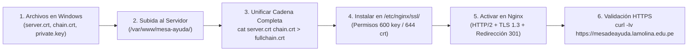

# 📘 Manual Integral de Administración y Despliegue: Mesa de Ayuda OTIC - UNALM

> **Audiencia:** Administradores de sistemas y desarrolladores con conocimientos básicos/intermedios.  
> **Servidor de Producción:** `172.16.0.49` (Puerto SSH: `7777`)  
> **Sistema Operativo:** AlmaLinux 10.2 (Familia Red Hat Enterprise Linux / RHEL)  
> **FileServer de Red:** `172.16.0.57` (`\\172.16.0.57\documentos`)  
> **Base de Datos Centralizada:** `172.16.0.189:3306` (`mesaayuda_db`)  
> **Dominio Oficial:** `mesadeayuda.lamolina.edu.pe`

---

## 📑 Tabla de Contenidos
1. [¿Cómo funciona el Sistema? (Arquitectura Simple)](#1-cómo-funciona-el-sistema-arquitectura-simple)
2. [Ficha de Parámetros y Credenciales de Red](#2-ficha-de-parámetros-y-credenciales-de-red)
3. [Conexión desde el Editor con Remote - SSH](#3-conexión-desde-el-editor-con-remote---ssh)
4. [Estructura del Proyecto en el Servidor](#4-estructura-del-proyecto-en-el-servidor)
5. [Instalación desde Cero y Configuración Base](#5-instalación-desde-cero-y-configuración-base)
6. [El FileServer de Red: Almacenamiento por Enlaces](#6-el-fileserver-de-red-almacenamiento-por-enlaces)
7. [Puesta en Marcha del Backend (Node.js + PM2)](#7-puesta-en-marcha-del-backend-nodejs--pm2)
8. [Compilación y Publicación del Frontend (React + Vite)](#8-compilación-y-publicación-del-frontend-react--vite)
9. [Configuración del Servidor Web (Nginx) y Cortafuegos](#9-configuración-del-servidor-web-nginx-y-cortafuegos)
10. [Instalación de Certificados SSL (HTTPS)](#10-instalación-de-certificados-ssl-https)
11. [Guía de Operaciones del Día a Día (Mantenimiento)](#11-guía-de-operaciones-del-día-a-día-mantenimiento)
12. [Solución de Problemas Comunes (Troubleshooting)](#12-solución-de-problemas-comunes-troubleshooting)

---

## 1. ¿Cómo funciona el Sistema? (Arquitectura Simple)

Para entender el sistema sin complicaciones técnicas excesivas, imagina 4 piezas que trabajan en equipo:

```mermaid
graph TD
    Usuario([Navegador del Usuario\nmesadeayuda.lamolina.edu.pe]) -->|Puerto 80 / 443| Nginx[Servidor Nginx\nRecibe las peticiones]
    
    subgraph Servidor Producción: 172.16.0.49
        Nginx -->|Entrega la pantalla visual| ReactDist[Frontend React Compilado\nclient/dist]
        Nginx -->|Envía consultas /api/| PM2[Backend Node.js con PM2\nPuerto 4000]
        Nginx -->|Descarga archivos /uploads/| MontajeFS[/srv/repositorio/documentos]
        PM2 -->|Guarda archivos físicos| MontajeFS
    end

    subgraph Red Central UNALM
        MontajeFS -.->|Montado por red CIFS| FileServer[FileServer: 172.16.0.57\nmesadeayuda-datos]
        PM2 -->|Lee y guarda datos| BD[(MySQL Central: 172.16.0.189)]
        PM2 -->|Valida usuarios institucionales| AD[Active Directory: 172.16.0.8]
        PM2 -->|Envía correos automáticos| Gmail[Google Workspace SMTP]
    end
```

### ¿Por qué está diseñado así?
* **Rendimiento:** Nginx entrega la interfaz gráfica web a los usuarios al instante.
* **Seguridad:** El backend (Node.js) corre de forma interna en el puerto `4000`, protegido detrás de Nginx.
* **Espacio en disco infinito:** El servidor web no se llena de archivos pesados. Cuando un usuario adjunta un PDF o foto a un ticket, el archivo viaja directamente al **FileServer** de 1,000 GB, y en la Base de Datos solo se registra el enlace o URL (`uploads/ticket_123.pdf`).

---

## 2. Ficha de Parámetros y Credenciales de Red

Guarda esta tabla como referencia de todos los componentes del ecosistema:

| Servicio / Rol | Host / IP | Puerto | Usuario / Identificador | Contraseña / Clave |
| :--- | :--- | :--- | :--- | :--- |
| **Servidor Web Producción** | `172.16.0.49` | `7777` (SSH) | `admin` | `@Unalm#2026%$` |
| **FileServer (`mesadeayuda-datos`)** | `172.16.0.57` | `445` (SMB) | `repomda` | `Unalm#1902&` |
| **Punto Montaje FileServer** | `/srv/repositorio/documentos` | - | Local en Linux | Persistente en `/etc/fstab` |
| **Base de Datos Central** | `172.16.0.189` | `3306` | `user_helpdesk` | `ayuda2026$` (DB: `mesaayuda_db`) |
| **Active Directory (LDAP)** | `172.16.0.8` | `636` (LDAPS) | `mesadeayuda@lamolina.edu.pe` | `@Unalm%2026#` |
| **Notificador de Correos** | `smtp.gmail.com` | `587` | `notificaciones.mesadeayuda@lamolina.edu.pe` | `qmhiirwmofafwbvy` |
| **Repositorio GitHub** | `github.com` | `443` | `jeferlpx/MESA_AYUDA_UNALM` | Rama `main` (Público) |

---

## 3. Conexión desde el Editor con Remote - SSH

Para conectarte desde tu computadora con la extensión **Remote - SSH (Open Source)**:

### 3.1 Tu archivo de configuración local en Windows
Ubicación: `C:\Users\<TU_USUARIO>\.ssh\config`
Debe contener este bloque:

```ssh-config
Host mesadeayuda
    HostName 172.16.0.49
    User admin
    Port 7777
    StrictHostKeyChecking no
    UserKnownHostsFile /dev/null
```

### 3.2 Pasos para entrar:
1. Presiona `Ctrl + Shift + P` en tu editor.
2. Escribe y elige: **`Remote-SSH: Connect to Host...`**
3. Haz clic en **`mesadeayuda`**.
4. Te pedirá la contraseña:
   ```text
   @Unalm#2026%$
   ```
5. En la esquina inferior izquierda verás: **`SSH: mesadeayuda`**.
6. Ve a **File > Open Folder...**, escribe `/var/www/mesa-ayuda` y presiona **Enter**.

> [!TIP]
> **¿Por qué fallaba antes?**  
> En las distribuciones Enterprise como AlmaLinux, la herramienta `wget` no viene preinstalada. La extensión Remote-SSH la necesita obligatoriamente para descargar su motor en el servidor. Al instalar `wget` en el servidor, la conexión quedó 100% resuelta.

---

## 4. Estructura del Proyecto en el Servidor

Dentro de `/var/www/mesa-ayuda/` encontrarás dos carpetas principales:

```text
/var/www/mesa-ayuda/
│
├── client/                     <-- CÓDIGO DEL FRONTEND (Lo que ve el usuario)
│   ├── src/                    <-- Componentes React, pantallas, estilos
│   ├── dist/                   <-- CARPETA COMPILADA FINAL (la que lee Nginx)
│   └── package.json            <-- Librerías de React
│
├── server/                     <-- CÓDIGO DEL BACKEND (La lógica y base de datos)
│   ├── src/                    <-- Rutas, controladores de tickets, LDAP, SMTP
│   ├── dist/                   <-- CARPETA COMPILADA (JavaScript listo para producción)
│   ├── .env                    <-- VARIABLES SECRETAS (BD, contraseñas, correos)
│   ├── ecosystem.config.cjs    <-- Archivo de configuración para PM2
│   └── package.json            <-- Librerías de Node.js
│
└── /srv/repositorio/documentos <-- CARPETA DEL FILESERVER (Montaje de red de 1 TB)
```

---

## 5. Instalación desde Cero y Configuración Base

Si en el futuro necesitas formatear el servidor o replicar este entorno en otra máquina, estos son los comandos base ejecutados con privilegios de administrador:

```bash
# 1. Actualizar el sistema e instalar utilitarios imprescindibles
# NOTA: En AlmaLinux se usa 'dnf', no 'apt'.
sudo dnf update -y
sudo dnf install -y git wget curl tar unzip bzip2 which cifs-utils nginx policycoreutils-python-utils

# 2. Instalar Node.js 22 LTS
sudo dnf install -y nodejs

# 3. Instalar PM2 para mantener el backend encendido 24/7
sudo npm install -g pm2

# 4. Crear un enlace directo a PM2 (para que 'sudo' lo reconozca siempre)
sudo ln -sf /usr/local/bin/pm2 /usr/bin/pm2

# 5. Abrir puertos HTTP (80) y HTTPS (443) en el cortafuegos
sudo firewall-cmd --permanent --add-service=http --add-service=https
sudo firewall-cmd --reload

# 6. Permitir en SELinux que el servidor web use la red y carpetas compartidas
sudo setsebool -P httpd_can_network_connect 1
sudo setsebool -P httpd_use_cifs 1
```

---

## 6. El FileServer de Red: Almacenamiento por Enlaces

### 6.1 Cómo se vincula el FileServer (`172.16.0.57`) al servidor Web
El servidor de producción tiene montada la carpeta compartida en `/srv/repositorio/documentos`.

#### Archivo de credenciales protegido:
En `/etc/cifs-credentials-mesadeayuda` (visible solo para root con permisos `600`):
```text
username=repomda
password=Unalm#1902&
```

#### Montaje automático permanente en `/etc/fstab`:
Esta línea asegura que si el servidor se reinicia, el FileServer se conecte solo:
```text
//172.16.0.57/documentos /srv/repositorio/documentos cifs credentials=/etc/cifs-credentials-mesadeayuda,uid=nginx,gid=nginx,file_mode=0775,dir_mode=0775,vers=3.0,_netdev 0 0
```

### 6.2 Cómo funciona el almacenamiento por enlaces
1. **Subida:** En `/var/www/mesa-ayuda/server/.env` está configurado:
   ```env
   UPLOAD_DIR=/srv/repositorio/documentos
   ```
   Cuando un usuario sube un archivo, Node.js lo guarda físicamente dentro del FileServer.
2. **Registro en Base de Datos:**
   El backend guarda únicamente una ruta corta:
   ```text
   uploads/ticket_458_foto.jpg
   ```
3. **Descarga / Visualización:**
   Nginx tiene una regla especial: cualquier petición que empiece con `/uploads/` la busca directamente en `/srv/repositorio/documentos/` y la entrega al navegador con velocidad máxima.

---

## 7. Puesta en Marcha del Backend (Node.js + PM2)

### 7.1 El archivo de variables de entorno (`server/.env`)
Ubicación: `/var/www/mesa-ayuda/server/.env`

```env
PORT=4000
NODE_ENV=production
API_PREFIX=/api

# Base de Datos Centralizada UNALM
DB_HOST=172.16.0.189
DB_PORT=3306
DB_USER=user_helpdesk
DB_PASSWORD=ayuda2026$
DB_PASS=ayuda2026$
DB_NAME=mesaayuda_db
DB_CONNECTION_LIMIT=20

# Seguridad JWT
JWT_SECRET=MesaAyudaOticUnalm2026SecretKey
JWT_EXPIRES_IN=24h

# Almacenamiento en FileServer
UPLOAD_DIR=/srv/repositorio/documentos
MAX_FILE_SIZE_BYTES=10485760

# Dominio
ALLOWED_ORIGIN=*
APP_URL=https://mesadeayuda.lamolina.edu.pe

# Notificaciones por Correo SMTP
SMTP_HOST=smtp.gmail.com
SMTP_PORT=587
SMTP_SECURE=false
SMTP_USER=notificaciones.mesadeayuda@lamolina.edu.pe
SMTP_PASS=qmhiirwmofafwbvy
SMTP_FROM="Mesa de Ayuda OTIC UNALM <notificaciones.mesadeayuda@lamolina.edu.pe>"
MESA_AYUDA_EMAIL=notificaciones.mesadeayuda@lamolina.edu.pe

# Active Directory (Directorio Activo LDAP UNALM)
LDAP_ENABLED=true
LDAP_URL=ldaps://172.16.0.8:636
LDAP_BASE_DN=DC=lamolina,DC=edu,DC=pe
LDAP_DOMAIN=lamolina.edu.pe
LDAP_BIND_DN=mesadeayuda@lamolina.edu.pe
LDAP_BIND_PASSWORD=@Unalm%2026#
LDAP_TIMEOUT_MS=6000
```

### 7.2 Comandos para compilar y arrancar el backend:
```bash
# Entrar a la carpeta del servidor
cd /var/www/mesa-ayuda/server

# Instalar dependencias
npm install

# Compilar de TypeScript a JavaScript de alto rendimiento
npm run build

# Iniciar el proceso con PM2
pm2 start ecosystem.config.cjs

# Guardar la lista para que arranque con el servidor
pm2 save
```

---

## 8. Compilación y Publicación del Frontend (React + Vite)

El frontend no se ejecuta en segundo plano como el backend; se "compila" en archivos HTML, JS y CSS optimizados:

```bash
# Entrar a la carpeta del cliente
cd /var/www/mesa-ayuda/client

# Instalar librerías
npm install

# Compilar el sitio web
npm run build
```
Al terminar, se genera la carpeta `/var/www/mesa-ayuda/client/dist/`, la cual Nginx entrega al público.

---

## 9. Configuración del Servidor Web (Nginx) y Cortafuegos

El archivo de configuración principal del sitio está ubicado en:
`/etc/nginx/conf.d/mesadeayuda.conf`

Este archivo administra tanto la redirección segura a HTTPS como la entrega del Frontend, la API y los adjuntos del FileServer.

```nginx
# ==============================================================================
# CONFIGURACIÓN MESA DE AYUDA OTIC - UNALM (PRODUCCIÓN)
# ==============================================================================

# 1. Redirección automática de HTTP a HTTPS para el dominio oficial
server {
    listen 80;
    listen [::]:80;
    server_name mesadeayuda.lamolina.edu.pe;

    return 301 https://$host$request_uri;
}

# 2. Servidor HTTP estándar (acceso directo por IP local o contingencia)
server {
    listen 80 default_server;
    listen [::]:80 default_server;
    server_name 172.16.0.49 localhost _;

    client_max_body_size 30M;

    # Frontend React SPA
    location / {
        root /var/www/mesa-ayuda/client/dist;
        index index.html index.htm;
        try_files $uri $uri/ /index.html;
    }

    # Proxy inverso API Node.js
    location /api/ {
        proxy_pass http://127.0.0.1:4000/api/;
        proxy_http_version 1.1;
        proxy_set_header Upgrade $http_upgrade;
        proxy_set_header Connection "upgrade";
        proxy_set_header Host $host;
        proxy_cache_bypass $http_upgrade;
        proxy_set_header X-Real-IP $remote_addr;
        proxy_set_header X-Forwarded-For $proxy_add_x_forwarded_for;
        proxy_set_header X-Forwarded-Proto $scheme;
    }

    # Servir archivos adjuntos desde el FileServer montado
    location /uploads/ {
        alias /srv/repositorio/documentos/;
        expires 30d;
        add_header Cache-Control "public, no-transform";
    }

    location /app/uploads/ {
        alias /srv/repositorio/documentos/;
        expires 30d;
        add_header Cache-Control "public, no-transform";
    }
}

# 3. Servidor HTTPS Seguro (Producción Oficial)
server {
    listen 443 ssl default_server;
    listen [::]:443 ssl default_server;
    http2 on;
    server_name mesadeayuda.lamolina.edu.pe 172.16.0.49 localhost;

    # Certificados SSL Institucionales (*.lamolina.edu.pe)
    ssl_certificate /etc/nginx/ssl/fullchain.crt;
    ssl_certificate_key /etc/nginx/ssl/private.key;

    # Protocolos y Cifrados Criptográficos Seguros
    ssl_protocols TLSv1.2 TLSv1.3;
    ssl_ciphers HIGH:!aNULL:!MD5;
    ssl_prefer_server_ciphers on;
    ssl_session_cache shared:SSL:10m;
    ssl_session_timeout 10m;

    # Cabeceras de seguridad web
    add_header X-Content-Type-Options "nosniff" always;
    add_header X-Frame-Options "SAMEORIGIN" always;
    add_header X-XSS-Protection "1; mode=block" always;

    # Tamaño máximo de adjuntos (30 MB)
    client_max_body_size 30M;

    # Frontend React SPA
    location / {
        root /var/www/mesa-ayuda/client/dist;
        index index.html index.htm;
        try_files $uri $uri/ /index.html;
    }

    # Proxy inverso API Node.js
    location /api/ {
        proxy_pass http://127.0.0.1:4000/api/;
        proxy_http_version 1.1;
        proxy_set_header Upgrade $http_upgrade;
        proxy_set_header Connection "upgrade";
        proxy_set_header Host $host;
        proxy_cache_bypass $http_upgrade;
        proxy_set_header X-Real-IP $remote_addr;
        proxy_set_header X-Forwarded-For $proxy_add_x_forwarded_for;
        proxy_set_header X-Forwarded-Proto https;
    }

    # Servir archivos adjuntos desde el FileServer montado
    location /uploads/ {
        alias /srv/repositorio/documentos/;
        expires 30d;
        add_header Cache-Control "public, no-transform";
    }

    location /app/uploads/ {
        alias /srv/repositorio/documentos/;
        expires 30d;
        add_header Cache-Control "public, no-transform";
    }
}
```

> [!NOTE]
> **Bloque por defecto de AlmaLinux desactivado:**  
> En `/etc/nginx/nginx.conf` se comentaron las líneas 37 a 45 (el bloque `server { listen 80; ... }` por defecto de bienvenida de AlmaLinux) para evitar advertencias de conflicto con el puerto 80.

Cada vez que modifiques la configuración de Nginx, ejecuta:
```bash
# Probar que no existan errores de sintaxis
sudo nginx -t

# Recargar los cambios inmediatamente sin interrumpir el servicio
sudo systemctl reload nginx
```

---

## 10. Instalación de Certificados SSL (HTTPS) — Guía Paso a Paso

Esta sección documenta el proceso exacto ejecutado para instalar y poner en marcha el certificado SSL comodín (*wildcard*) institucional `*.lamolina.edu.pe` (emitido por Entrust OV TLS Issuing RSA CA 2, con vigencia hasta diciembre de 2026).



### Paso 1: Identificación de los archivos entregados
El área de redes entrega 3 componentes:
1. `server.crt`: Certificado de dominio emitido para `*.lamolina.edu.pe`.
2. `chain.crt`: Cadena de autoridades intermedias de certificación (Entrust / Sectigo / USERTrust).
3. `private.key`: Llave privada RSA correspondiente al certificado.

### Paso 2: Subida desde Windows hacia el Servidor
Si subes los archivos arrastrándolos desde el explorador del editor o vía SFTP hacia `/var/www/mesa-ayuda/certificado https/`, asegúrate de que tu usuario tenga permisos de escritura (ver Caso 5 del Troubleshooting si sale error `EACCES: permission denied`).

### Paso 3: Validación de integridad y correspondencia de la clave
Antes de instalar, se debe verificar que la llave privada pertenezca exactamente al certificado:
```bash
# Verificar el Hash MD5 del módulo de la clave y del certificado
openssl x509 -noout -modulus -in "/var/www/mesa-ayuda/certificado https/server.crt" | openssl md5
openssl rsa -noout -modulus -in "/var/www/mesa-ayuda/certificado https/private.key" | openssl md5
```
Ambos resultados deben ser **idénticos**.

### Paso 4: Creación de la Cadena Completa (Full Chain)
Nginx requiere que el certificado público contenga primero el certificado del servidor y luego los certificados intermedios en un solo archivo:
```bash
# Crear la carpeta de destino segura
sudo mkdir -p /etc/nginx/ssl

# Unificar el certificado y la cadena intermedia
sudo bash -c 'cat "/var/www/mesa-ayuda/certificado https/server.crt" "/var/www/mesa-ayuda/certificado https/chain.crt" > /etc/nginx/ssl/fullchain.crt'

# Copiar la llave privada y los originales como respaldo
sudo cp "/var/www/mesa-ayuda/certificado https/private.key" /etc/nginx/ssl/private.key
sudo cp "/var/www/mesa-ayuda/certificado https/server.crt" /etc/nginx/ssl/server.crt
sudo cp "/var/www/mesa-ayuda/certificado https/chain.crt" /etc/nginx/ssl/chain.crt
```

### Paso 5: Aplicación de permisos seguros y contexto SELinux
La llave privada nunca debe ser legible por usuarios no autorizados:
```bash
# Permiso 600: Solo root puede leer la clave privada
sudo chmod 600 /etc/nginx/ssl/private.key

# Permiso 644: Certificados legibles por el servidor
sudo chmod 644 /etc/nginx/ssl/*.crt

# Asegurar el contexto de seguridad SELinux para Nginx
sudo restorecon -Rv /etc/nginx/ssl
```

### Paso 6: Configurar resolución local en `/etc/hosts`
Para que el servidor pueda consultarse a sí mismo por el nombre de dominio oficial:
```bash
# Agregar al final de /etc/hosts si aún no está presente
grep -q "mesadeayuda.lamolina.edu.pe" /etc/hosts || echo "127.0.0.1 mesadeayuda.lamolina.edu.pe" | sudo tee -a /etc/hosts
```

### Paso 7: Probar y recargar Nginx
```bash
sudo nginx -t
sudo systemctl reload nginx
```

### Paso 8: Validación de funcionamiento en el Servidor
Ejecuta la prueba de conexión TLS y HTTP/2:
```bash
# Probar conexión segura HTTPS
curl -Iv https://mesadeayuda.lamolina.edu.pe

# Probar la redirección automática de HTTP a HTTPS (debe responder HTTP 301)
curl -I http://mesadeayuda.lamolina.edu.pe

# Probar respuesta de la API Node.js sobre HTTPS
curl -s https://mesadeayuda.lamolina.edu.pe/api/catalog/categories
```

### Paso 9: Acceso desde computadoras cliente (Windows)
1. Abre tu navegador y accede a:  
   **`https://mesadeayuda.lamolina.edu.pe`**
2. Verás el candado de conexión segura activa y el certificado emitido para `*.lamolina.edu.pe`.
3. Si el área de redes de la universidad aún está en proceso de propagar el registro DNS interno en la red institucional, puedes mapearlo temporalmente en tu máquina Windows:
   - Abre el **Bloc de notas** como Administrador.
   - Abre el archivo: `C:\Windows\System32\drivers\etc\hosts`
   - Agrega al final la línea:
     ```text
     172.16.0.49 mesadeayuda.lamolina.edu.pe
     ```
   - Guarda los cambios y refresca tu navegador.

---

## 11. Guía de Operaciones del Día a Día (Mantenimiento)

### ¿Cómo actualizar el sistema cuando se hacen cambios en GitHub?
Cuando tú o tu equipo suban mejoras o corrijan errores en el repositorio, sigue este procedimiento de 4 pasos:

```bash
# Paso 1: Descargar los cambios más recientes
cd /var/www/mesa-ayuda
git pull origin main

# Paso 2: Si hubo cambios en el Backend
cd /var/www/mesa-ayuda/server
npm install
npm run build
pm2 restart mesa-ayuda-backend

# Paso 3: Si hubo cambios en el Frontend (pantallas, botones, diseño)
cd /var/www/mesa-ayuda/client
npm install
npm run build

# Paso 4: Asegurar permisos correctos para Nginx y el usuario admin
sudo chown -R admin:nginx /var/www/mesa-ayuda
sudo chmod -R 775 /var/www/mesa-ayuda
sudo systemctl reload nginx
```

---

## 12. Solución de Problemas Comunes (Troubleshooting)

### Caso 1: La página no abre en el navegador
- **Paso 1:** Verifica si Nginx está encendido:
  ```bash
  sudo systemctl status nginx
  ```
- **Paso 2:** Si está detenido, inícialo:
  ```bash
  sudo systemctl start nginx
  ```
- **Paso 3:** Comprueba que el firewall permita HTTP y HTTPS:
  ```bash
  sudo firewall-cmd --list-services | grep -E "http|https"
  ```
  Si falta alguno:
  ```bash
  sudo firewall-cmd --permanent --add-service=http --add-service=https
  sudo firewall-cmd --reload
  ```

### Caso 2: El sistema abre pero da "Error de red" al iniciar sesión
- **Causa:** El backend de Node.js está apagado o no conecta con la base de datos central (`172.16.0.189`).
- **Verificación en terminal:**
  ```bash
  pm2 status
  ```
  - Si en `status` dice `errored` o `stopped`:
    ```bash
    pm2 logs mesa-ayuda-backend --lines 50
    ```
    Los logs te dirán con precisión si la contraseña de la BD cambió o si el puerto 3306 de `172.16.0.189` no responde.
  - Para reiniciar el backend:
    ```bash
    pm2 restart mesa-ayuda-backend
    ```

### Caso 3: No se pueden subir o ver archivos adjuntos
- **Causa:** El FileServer se desconectó de la red.
- **Verificación:**
  ```bash
  df -h | grep documentos
  ```
- **Solución:** Si no aparece en la lista, vuelve a montarlo:
  ```bash
  sudo mount -a
  ```
  *(El comando `mount -a` lee `/etc/fstab` y vuelve a conectar todo automáticamente)*.

### Caso 4: Error `EACCES: permission denied` al transferir archivos desde el editor
- **Causa:** La carpeta `/var/www/mesa-ayuda` pertenecía originalmente solo al usuario de sistema `nginx` con permisos restrictivos `755`. Al intentar arrastrar carpetas desde Windows mediante el editor conectado como `admin`, el sistema operativo deniega la creación de archivos.
- **Solución:** Asignar la propiedad compartida a `admin` (usuario) y `nginx` (grupo) con permisos `775`:
  ```bash
  sudo chown -R admin:nginx /var/www/mesa-ayuda
  sudo chmod -R 775 /var/www/mesa-ayuda
  ```
  > *Nota sobre la contraseña en Linux:* Al ejecutar comandos con `sudo`, la terminal solicita `[sudo] password for admin:`. Por seguridad de Unix, **no se imprimen caracteres ni asteriscos** en la pantalla mientras escribes. Simplemente escribe `@Unalm#2026%$` y presiona Enter.

### Caso 5: El navegador en Windows indica "No se puede acceder a este sitio" al entrar a `https://mesadeayuda.lamolina.edu.pe`
- **Causa:** El servidor de nombres DNS de la red universitaria aún no tiene registrado o delegado el subdominio `mesadeayuda.lamolina.edu.pe` hacia la dirección IP `172.16.0.49`.
- **Comprobación:** Desde una terminal de Windows (`cmd` o PowerShell), ejecuta:
  ```powershell
  ping mesadeayuda.lamolina.edu.pe
  ```
  Si no responde con `172.16.0.49`, debes solicitar al área de redes de la OTIC que agregue el registro DNS tipo `A`:
  `mesadeayuda.lamolina.edu.pe -> 172.16.0.49`
- **Solución inmediata en tu PC de trabajo:** Mapea el dominio en tu archivo de hosts local:
  Edita `C:\Windows\System32\drivers\etc\hosts` (como Administrador) y añade:
  ```text
  172.16.0.49 mesadeayuda.lamolina.edu.pe
  ```

### Caso 6: Error `80090308... AcceptSecurityContext error, data 52e` en autenticación LDAP
- **Causa:** En Microsoft Active Directory, el código `data 52e` significa `ERROR_LOGON_FAILURE` (nombre de usuario o contraseña incorrectos). Ocurre si la contraseña de la cuenta de servicio contiene caracteres especiales como `#` y no está entre comillas en `server/.env`, haciendo que la librería `dotenv` interprete el `#` como un comentario y recorte la clave antes de enviarla al Domain Controller.
- **Solución:**
  1. En `/var/www/mesa-ayuda/server/.env`, asegúrate de que `LDAP_BIND_PASSWORD` esté entre comillas dobles:
     ```env
     LDAP_BIND_DN="mesadeayuda@lamolina.edu.pe"
     LDAP_BIND_PASSWORD="@Unalm%2026#"
     ```
  2. Reinicia el backend con actualización de variables en PM2:
     ```bash
     sudo pm2 restart mesa-ayuda-backend --update-env
     ```

### Caso 7: Comandos de monitoreo rápido

| ¿Qué quiero saber? | Comando a ejecutar |
| :--- | :--- |
| **¿El backend está vivo?** | `pm2 status` |
| **Ver errores del backend en tiempo real** | `pm2 logs` |
| **¿El servicio Nginx está activo?** | `sudo systemctl status nginx` |
| **Ver registros de acceso HTTPS de Nginx** | `sudo tail -f /var/log/nginx/access.log` |
| **Ver errores de Nginx** | `sudo tail -f /var/log/nginx/error.log` |
| **¿Cuánto espacio queda en el FileServer?** | `df -h /srv/repositorio/documentos` |
| **¿Cuánta memoria RAM está usando el servidor?** | `free -h` |
| **Verificar fecha de expiración del SSL** | `openssl x509 -enddate -noout -in /etc/nginx/ssl/fullchain.crt` |

---

## 11. Transición a Producción: Purga de Cuentas Locales y Sincronización con Directorio Activo (LDAP)

Para la puesta en marcha oficial en el entorno de producción institucional de la UNALM, se ejecutó la depuración total de las cuentas locales y de prueba:

### 11.1 Acciones Realizadas en la Base de Datos

1. **Depuración de Usuarios de Prueba:**
   - Se eliminaron por completo **1,276 cuentas ficticias/locales** que no contaban con tickets asociados.
   - Se preservaron **7 cuentas históricas con estado `INACTIVO`** para salvaguardar la integridad referencial de base de datos (`FOREIGN KEY` en `tickets.solicitante_id` y `tickets.tecnico_id`).
2. **Importación Oficial desde Directorio Activo:**
   - Se consultó el Domain Controller institucional (`ldaps://172.16.0.8:636`) bajo el Base DN `DC=lamolina,DC=edu,DC=pe`.
   - Se obtuvieron y procesaron **185 cuentas institucionales reales**, registrando 182 usuarios activos con sus nombres, apellidos, correos `@lamolina.edu.pe` y dependencias organizacionales.
3. **Cuenta Maestra de Administrador General:**
   - Se configuró la cuenta de superadministrador maestro para gestión total del sistema:
     - **Usuario:** `admin` (o `admin@lamolina.edu.pe`)
     - **Contraseña:** `admin2026@`
     - **Rol:** `ADMIN` (`rol_id = 1` - Administrador General OTIC).
   - Se ingresa directamente desde la misma pantalla de login institucional (el sistema valida prioritariamente las credenciales locales de contingencia antes de consultar al Active Directory).
   - La cuenta de **Christian Alfredo Zacarías Casas** (`czacarias@lamolina.edu.pe`) mantiene su rol estándar de usuario institucional (`rol_id = 4`).

### 11.2 Modificaciones en la Interfaz de Usuario (Frontend)

1. **Pantalla de Inicio de Sesión (`LoginPage.tsx`):**
   - **Eliminado:** El panel y botones de *"Perfiles Rápidos de Demostración"* (admin, técnicos, mesa de ayuda, solicitante).
   - **Eliminado:** El botón y formulario de *"Ingresar con Cuenta Local"*.
   - **Eliminado:** Pestaña de autorregistro local.
   - **Establecido:** La pantalla de inicio de sesión queda exclusivamente configurada para el acceso institucional mediante **Directorio Activo (LDAP)** con credenciales `@lamolina.edu.pe`.
2. **Módulo de Administración de Usuarios (`AdminUsersPage.tsx`):**
   - Se incorporó en el encabezado el botón **"Sincronizar Directorio Activo"** que invoca el endpoint seguro `POST /api/users/sync-ldap`.
   - Permite a los administradores actualizar en cualquier momento nuevos ingresos o cambios organizacionales registrados en el controlador de dominio sin necesidad de reiniciar servicios.

### 11.3 Script de Sincronización Manual

Para ejecutar una sincronización directa desde la consola del servidor:
```bash
cd /var/www/mesa-ayuda/server
node scripts/sync-ldap-users.js
```
El script reportará el total de cuentas encontradas en el Domain Controller, las cuentas insertadas o actualizadas en MySQL y el estado de la conexión segura TLS.

### 11.4 Contacto de Referencia, Horario de Atención e Integración con WhatsApp

Para optimizar la comunicación operativa entre el personal técnico y los usuarios solicitantes:
1. **Formulario de Creación de Tickets (`SolicitantPortal.tsx`):**
   - **Contacto de Referencia (N° de Celular):** Campo obligatorio (`required`) para coordinar la visita técnica presencial.
   - **Horario de Disponibilidad / Atención:** Campo obligatorio (`required`) para especificar el rango horario preferente para acercarse a la oficina/laboratorio.
   - **Dropzone de Archivos Compacto (`FileUploader.tsx`):** Rediseñado a un formato horizontal elegante y compacto (~50px de altura), optimizando el espacio del modal sin perder la funcionalidad de arrastrar y soltar o comprimir imágenes.
2. **Botón de Contacto por WhatsApp (`WhatsAppButton.tsx` / `TicketDetailPage.tsx`):**
   - Incorporado en la vista de detalle de tickets (`TicketDetailPage.tsx`) y en el panel lateral de gestión de especialistas (`SpecialistDashboard.tsx`).
   - Detecta automáticamente el número móvil de 9 dígitos peruano y genera el enlace directo `https://wa.me/51...` con mensaje predeterminado contextualizado al código y título del ticket.
   - Permite al usuario solicitante contactar por WhatsApp al técnico asignado, y al personal técnico o mesa de ayuda contactar al solicitante o número de referencia en un solo clic.

### 11.5 Mejoras de Usabilidad Móvil, Modo Oscuro/Claro y Protección de Cuentas Administrativas

1. **Contacto Extra de Referencia y Celular de Perfil (`SolicitantPortal.tsx`):**
   - El campo **"Contacto de Referencia (N° de Celular) *"** inicia permanentemente en blanco (`''`) al abrir el modal de nuevo ticket, permitiendo ingresar un número alternativo o de la persona presente en el ambiente de trabajo.
   - Se agregó un banner informativo destacado dentro del modal que visualiza el **número de celular y anexo ya registrados en el perfil** del solicitante.
2. **Depuración de la Pantalla de Login (`LoginPage.tsx`):**
   - Se eliminó el enlace de diagnóstico técnico *"Verificar estado del enlace de Directorio Activo"*, presentando un inicio de sesión corporativo limpio y amigable.
3. **Modal Profesional de Sincronización LDAP (`AdminUsersPage.tsx`):**
   - Se reemplazó el cuadro nativo del navegador (`window.confirm`) por una ventana modal interactiva con iconografía institucional, detalles técnicos de conexión al Domain Controller (`172.16.0.8:636 LDAPS`) y botón con indicador de carga animado.
4. **Protección Permanente contra Error 401 post-sincronización (`sync-ldap-users.js`):**
   - Se incorporó una regla estricta en el script de sincronización para que la cuenta principal `admin` (`id: 1`, `admin@lamolina.edu.pe`) y todo usuario con rol operativo (`rol_id !== 4`) jamás sea inactivado o eliminado.
5. **Corrección de Legibilidad en Dependencias (`SearchableDependenciaSelect.tsx`):**
   - Se ajustaron las clases de contraste dinámico para que el texto seleccionado en el formulario de edición de usuarios se visualice en negro/gris oscuro en fondos claros y blanco en fondos oscuros.
6. **Diseño Full Responsivo y Alternancia de Tema (Modo Oscuro / Modo Claro):**
   - **Interruptor de Tema (`Navbar.tsx` & `ThemeContext.tsx`):** Botón con microinteracción en la esquina superior derecha con iconos de Sol (Modo Claro) y Luna (Modo Oscuro), guardando la preferencia del usuario en `localStorage`.
   - **Menú Móvil Desplegable (Hamburguesa):** En teléfonos celulares la barra lateral se oculta de forma fluida y se activa un botón de menú hamburguesa que abre un drawer lateral con fondo difuminado, optimizando la experiencia ergonómica en pantallas táctiles.


