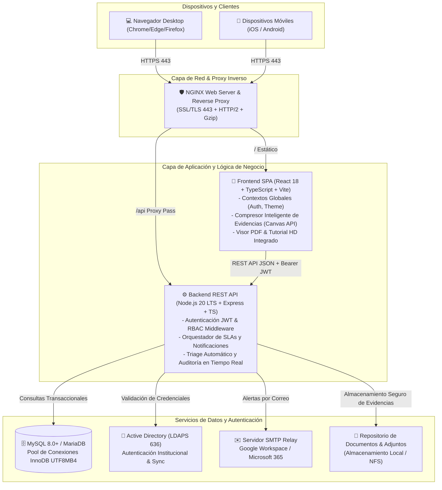

# 🏛️ Plataforma Integral de Mesa de Ayuda y Gestión de Servicios (ITIL v4)
### Solución Empresarial In-House para Tecnologías de Información (OTIC), Mantenimiento de Infraestructura (Servicios Generales) y Gestión Patrimonial

[](https://github.com/jeferlpx/MESA_AYUDA_UNALM/releases)
[](https://nodejs.org/)
[](https://react.dev/)
[](https://www.typescriptlang.org/)
[](https://www.mysql.com/)
[](https://tailwindcss.com/)
[](https://learn.microsoft.com/en-us/windows-server/identity/ad-ds/active-directory-domain-services)
[](https://www.axelos.com/)
[](https://www.docker.com/)

---

## 🌟 Visión General

La **Plataforma Integral de Mesa de Ayuda** es un sistema web de alto rendimiento diseñado para centralizar, automatizar y auditar la atención de incidencias técnicas, solicitudes de servicio, órdenes de trabajo de mantenimiento e inspecciones preventivas en instituciones públicas, universidades, ministerios, municipalidades y corporaciones privadas.

Construida bajo los estándares de mejores prácticas **ITIL v4**, la plataforma implementa:
- Gestión del ciclo de vida de tickets con control riguroso de acuerdos de nivel de servicio (**SLA**) en tiempo real.
- **Doble autenticación unificada**: integración nativa con controladores de dominio **Active Directory (LDAPS puerto 636)** y contingencia local con cifrado **bcrypt**.
- **Diseño Ultra Responsivo (Mobile First)** con soporte completo de **Modo Oscuro / Modo Claro** persistente.
- **Compresor inteligente de fotos y evidencias estilo WhatsApp**: comprime imágenes de hasta 25MB tomadas desde celulares a ~300KB en milisegundos sin pérdida perceptible de calidad antes de subir al servidor.
- **Herramientas de Mesa de Ayuda Avanzada**: registro de tickets de emergencia/regularización para usuarios presenciales/telefónicos y consolidación/anidación de tickets duplicados.
- **Módulo de Depuración Administrativa con PIN Maestro (`1308`)**: purga definitiva física y lógica de tickets de prueba o auditoría.
- **Trazabilidad Patrimonial (Hoja de Vida de Equipos)**: consulta del historial de reparaciones y mantenimientos por código patrimonial / número de serie.

---

## 🏗️ Arquitectura del Sistema



---

## 🎯 Matriz de Roles y Control de Acceso (RBAC)

La plataforma dispone de un control de acceso granular basado en 6 roles principales:

| Rol | Código | Ámbito y Capacidades Principales |
| :--- | :---: | :--- |
| **Administrador General** | `ADMIN` | Control total del sistema: gestión de usuarios, roles, catálogo de servicios, tiempos SLA, configuración de alertas, módulo de solicitudes de cuenta AD, auditoría global y depuración física de tickets con PIN maestro. |
| **Supervisor OTIC / Jefatura** | `SUPERVISOR` | Monitoreo directivo, control de cumplimiento de SLAs, reasignación de personal técnico, reportes ejecutivos, métricas e inspección de calidad de servicio. |
| **Mesa de Ayuda OTIC** | `MESA_AYUDA_OTIC` | Triage de tickets de tecnologías, evaluación de complejidad, derivación a especialistas, registro de tickets de emergencia/regularización y unificación de tickets duplicados. |
| **Mesa de Ayuda Servicios Generales** | `MESA_AYUDA_SG` | Recepción, evaluación y asignación de órdenes de mantenimiento de infraestructura, instalaciones sanitarias, eléctricas, carpintería, cerrajería y obras civiles. |
| **Técnico Especialista** | `TECNICO` / `TECNICO_SG` | Atención de tickets asignados, cambio de estados (En Proceso, En Espera, Resuelto), registro de diagnósticos técnicos, adjuntos de solución, materiales consumidos y firma de conformidad. |
| **Usuario Solicitante** | `SOLICITANTE` | Creación de tickets desde el catálogo visual, seguimiento en tiempo real, visualización de historial de atenciones, consulta de hoja de vida de bienes y calificación mediante encuesta de satisfacción con estrellas. |

---

## ⚡ Capacidades Destacadas (v2.6.0)

### 1. 📱 Diseño Ultra Responsivo y Modo Oscuro / Claro
- Interfaz adaptativa optimizada para teléfonos móviles, tablets y monitores ultrawide.
- Sistema de temas (Dark/Light mode) con selector accesible en cabecera y persistencia automática en `localStorage`.
- En dispositivos móviles, las tablas complejas se transforman automáticamente en tarjetas táctiles inteligentes sin scroll horizontal indeseado.

### 2. 🗜️ Compresor de Imágenes Inteligente (Client-Side)
- Soporte para adjuntar evidencias y fotos tomadas en alta resolución con celulares modernos (hasta 25MB por imagen).
- Algoritmo de compresión adaptativo estilo WhatsApp ejecutado en el navegador del cliente mediante Canvas / Web API.
- Reduce el consumo de datos móviles y el almacenamiento en el servidor en más del **90%**, convirtiendo fotos pesadas en imágenes optimizadas de ~300KB antes de transmitirse por la red.

### 3. 📖 Visor de Manual de Usuario y Video Tutorial HD en Pantalla de Login
- Botones de acceso directo en la pantalla de bienvenida para consulta rápida de nuevos usuarios.
- **Manual de Usuario Oficial**: Apertura directa del documento ilustrado paso a paso en pestaña limpia sin bloqueos de interfaz.
- **Video Tutorial HD**: Modal interactivo integrado con reproductor HTML5 de alto rendimiento para inducción del personal institucional.

### 4. 🔗 Unificación y Anidación de Tickets Duplicados
- Solución al problema común de múltiples reportes sobre un mismo corte de red o falla masiva.
- Los operadores de Mesa de Ayuda pueden seleccionar tickets correlacionados y consolidarlos bajo un **Ticket Maestro**, registrando obligatoriamente la justificación para auditoría.
- Los tickets secundarios pasan a estado `UNIFICADO_ANIDADO` cerrándose de forma ordenada y conservando su trazabilidad.

### 5. 🚨 Tickets de Emergencia y Regularización
- Permite al operador registrar requerimientos recibidos por llamada telefónica, WhatsApp o ventanilla presencial.
- Búsqueda predictiva contra el Directorio Activo institucional (`LDAP`), protegiendo cuentas de administración general contra asignaciones accidentales.

### 6. 🔒 Depuración Administrativa de Tickets con PIN Maestro (`1308`)
- Módulo de protección de alto nivel exclusivo para el Administrador General.
- Permite la eliminación definitiva (hard purge) de tickets de prueba o pruebas de carga, eliminando registros en cascada y archivos adjuntos del disco.
- Requiere autenticación de dos factores con PIN maestro configurable por variable de entorno (`ADMIN_PURGE_PIN`).

### 7. 📋 Gestión Centralizada de Solicitudes de Cuenta Active Directory
- Vista administrativa para gestionar los registros realizados desde la pestaña «Registrarme» del login.
- Filtro por estados (`PENDIENTE`, `EN_PROCESO`, `ATENDIDO`, `RECHAZADO`), buscador por DNI, nombres o correo, y seguimiento de peticiones de personal nuevo (CAS, locadores, contratados).

### 8. 🔍 Hoja de Vida de Bienes Patrimoniales
- Permite rastrear todos los incidentes y mantenimientos realizados sobre una computadora, proyector, impresora o vehículo institucional mediante su código de inventario.

---

## 🛠️ Stack Tecnológico

| Componente | Tecnología | Versión | Descripción |
| :--- | :--- | :---: | :--- |
| **Frontend Framework** | React | `18.3.1` | Single Page Application basada en componentes funcionales y Hooks |
| **Lenguaje Frontend** | TypeScript | `5.4.5` | Tipado estático estricto para modelos, estados y APIs |
| **Bundler & Build Tool** | Vite | `5.2.11` | Compilación ultrarrápida, HMR instantáneo y optimización de assets |
| **Estilos & UI** | Tailwind CSS | `3.4.3` | Utility-first CSS con paleta institucional, glassmorphism y dark mode |
| **Íconos** | Lucide React | `0.378.0` | Conjunto moderno y ligero de íconos vectoriales SVG |
| **Backend Runtime** | Node.js | `20 LTS` | Entorno de ejecución JavaScript del lado del servidor |
| **Framework Backend** | Express | `4.19.2` | Framework HTTP para API RESTful |
| **Lenguaje Backend** | TypeScript | `5.4.5` | Backend fuertemente tipado compilado a JavaScript ECMAScript 2022 |
| **Base de Datos** | MySQL / MariaDB | `8.0+ / 10.5+` | Motor relacional InnoDB con transacciones ACID y UTF8MB4 |
| **Driver MySQL** | `mysql2/promise` | `3.9.7` | Cliente de alto rendimiento con pool de conexiones asíncrono |
| **Autenticación LDAP** | `ldapts` | `9.2.0` | Cliente TypeScript puro para conexión segura LDAPS (puerto 636) |
| **Seguridad de Tokens** | `jsonwebtoken` | `9.0.2` | Tokens firmados con algoritmo HMAC-SHA256 con expiración configurable |
| **Cifrado de Claves** | `bcryptjs` | `2.4.3` | Hashing unidireccional con salt rounds adaptativos |
| **Envío de Correos** | `nodemailer` | `9.0.5` | Cliente SMTP con soporte TLS/STARTTLS para Gmail y Microsoft 365 |
| **Carga de Archivos** | `multer` | `1.4.5` | Procesamiento multipart/form-data con validación de tipo y tamaño |
| **Gestor de Procesos** | PM2 | `5.3+` | Gestión de clúster, auto-reinicio, balanceo de carga y logs |
| **Servidor Proxy** | Nginx | `1.20+` | Terminación SSL/TLS, compresión gzip/brotli y proxy inverso |

---

## 📁 Estructura del Repositorio

```
MESA_AYUDA_UNALM/
├── .env.example                     # Plantilla completa de variables de entorno para producción
├── .gitignore                       # Reglas de exclusión de seguridad (credenciales y temporales)
├── README.md                        # Documentación principal del sistema
├── MANUAL_DE_DESPLIEGUE_Y_CONFIGURACION.md # Guía técnica de instalación paso a paso en Linux
├── schema.sql                       # Esquema DDL de MySQL con tablas relacionales y seeders
├── docker-compose.yml               # Orquestación de contenedores Docker (DB, Backend, Frontend)
├── config/
│   ├── .env.example                 # Variables de entorno para despliegue dockerizado
│   ├── nginx.conf                   # Configuración del servidor Nginx con SSL/TLS
│   └── init-db/
│       └── 01-schema.sql            # Script de inicialización para contenedor MySQL
├── server/                          # Backend API REST (Node.js + Express + TypeScript)
│   ├── src/
│   │   ├── config/                  # Conexión a BD MySQL, inicialización y entorno
│   │   ├── controllers/             # Controladores de negocio (tickets, auth, users, admin, etc.)
│   │   ├── middlewares/             # Middlewares JWT, RBAC, subida de archivos con Multer
│   │   ├── models/                  # Consultas transaccionales y modelos SQL
│   │   ├── routes/                  # Definición de rutas y endpoints de la API
│   │   ├── services/                # Servicios de Active Directory (LDAP) y correo (SMTP)
│   │   ├── utils/                   # Utilidades de SLA, cálculo de prioridad y correlativos
│   │   └── app.ts                   # Punto de entrada de la aplicación Express
│   ├── scripts/                     # Scripts de automatización (sincronizador LDAP en lote)
│   ├── package.json                 # Dependencias y scripts del backend
│   └── tsconfig.json                # Configuración de compilación TypeScript
└── client/                          # Frontend SPA (React 18 + TypeScript + Vite)
    ├── public/                      # Assets estáticos (logos institucionales, favicon, manuales)
    │   ├── manual/                  # Manual PDF ilustrado y video tutorial MP4
    │   ├── escudo-color.png         # Escudo / Logotipo institucional oficial
    │   └── favicon.png              # Favicon de la aplicación
    ├── src/
    │   ├── components/              # Componentes visuales reutilizables (modales, tablas, botones)
    │   ├── context/                 # Contextos de React (AuthContext, ThemeContext)
    │   ├── data/                    # Estructura orgánica institucional y dependencias
    │   ├── pages/                   # Vistas principales adaptadas según el rol del usuario
    │   ├── services/                # Cliente HTTP Axios / Fetch para llamadas a la API
    │   ├── types/                   # Definición de interfaces y tipos TypeScript
    │   ├── App.tsx                  # Enrutador principal y layout
    │   └── main.tsx                 # Entrada y renderizado en DOM
    ├── package.json                 # Dependencias y scripts del frontend
    ├── tailwind.config.js           # Configuración de estilos y temas de Tailwind
    └── vite.config.ts               # Configuración de empaquetado Vite
```

---

## ⚙️ Guía de Instalación y Puesta en Marcha

### Opción 1: Despliegue en Servidor Físico / VPS Linux (RHEL, AlmaLinux, Ubuntu, Debian)

#### 1. Clonar el Repositorio
```bash
git clone https://github.com/jeferlpx/MESA_AYUDA_UNALM.git /var/www/mesa-ayuda
cd /var/www/mesa-ayuda
```

#### 2. Crear e Inicializar la Base de Datos MySQL
```bash
mysql -u root -p -e "CREATE DATABASE mesaayuda_db CHARACTER SET utf8mb4 COLLATE utf8mb4_unicode_ci;"
mysql -u root -p mesaayuda_db < schema.sql
```

#### 3. Configurar el Entorno del Backend
```bash
cp .env.example server/.env
nano server/.env
```
*Configure sus credenciales de base de datos (`DB_HOST`, `DB_USER`, `DB_PASSWORD`), clave de sesión (`JWT_SECRET`), parámetros LDAP y credenciales SMTP.*

#### 4. Instalar Dependencias y Compilar
```bash
# Compilar Backend
cd /var/www/mesa-ayuda/server
npm install
npm run build

# Compilar Frontend
cd /var/www/mesa-ayuda/client
npm install
npm run build
```

#### 5. Poner en Marcha el Servicio con PM2
```bash
cd /var/www/mesa-ayuda/server
pm2 start dist/app.js --name "mesa-ayuda-backend" -i max
pm2 save
pm2 startup
```

#### 6. Configurar Nginx como Proxy Inverso y Servidor Web
Vincule la carpeta `client/dist` al bloque `root` y redirija las solicitudes `/api/` hacia `http://127.0.0.1:4000`:
```nginx
server {
    listen 80;
    server_name mesadeayuda.tuentidad.gob.pe;
    return 301 https://$host$request_uri;
}

server {
    listen 443 ssl http2;
    server_name mesadeayuda.tuentidad.gob.pe;

    ssl_certificate /etc/ssl/certs/tu_certificado.crt;
    ssl_certificate_key /etc/ssl/certs/tu_clave_privada.key;

    root /var/www/mesa-ayuda/client/dist;
    index index.html;

    client_max_body_size 30M;

    location / {
        try_files $uri $uri/ /index.html;
    }

    location /api/ {
        proxy_pass http://127.0.0.1:4000;
        proxy_http_version 1.1;
        proxy_set_header Upgrade $http_upgrade;
        proxy_set_header Connection 'upgrade';
        proxy_set_header Host $host;
        proxy_cache_bypass $http_upgrade;
        proxy_set_header X-Real-IP $remote_addr;
        proxy_set_header X-Forwarded-For $proxy_add_x_forwarded_for;
        proxy_set_header X-Forwarded-Proto $scheme;
    }

    location /uploads/ {
        alias /var/www/mesa-ayuda/uploads/;
        expires 30d;
        add_header Cache-Control "public, no-transform";
    }
}
```
Recargue la configuración del servidor web:
```bash
sudo nginx -t && sudo systemctl reload nginx
```

---

### Opción 2: Despliegue Rápido con Docker Compose

Si prefiere un entorno aislado y autocontenido con contenedores Docker:

```bash
cp .env.example .env
docker-compose up -d --build
```

Esto desplegará de forma automática:
- Contenedor **MySQL 8.0** con la base de datos inicializada y persistente.
- Contenedor **Backend API (Node.js)** exponiendo el servicio en el puerto `4000`.
- Contenedor **Frontend SPA (Nginx)** sirviendo la aplicación en los puertos `80` y `443`.

---

## 🔑 Credenciales de Demostración Preconfiguradas

Para facilitar la auditoría y validación del sistema en ambientes de pruebas, el script `schema.sql` genera las siguientes cuentas de prueba:

| Rol | Correo de Acceso | Contraseña Inicial | Propósito en el Flujo |
| :--- | :--- | :--- | :--- |
| **Administrador General** | `admin` (o `admin@lamolina.edu.pe`) | `admin2026@` | Acceso a todos los módulos, gestión de usuarios, catálogo, SLAs y PIN `1308`. |
| **Supervisor OTIC** | `supervisor.otic@lamolina.edu.pe` | `Unalm2026#` | Monitoreo general de atenciones y cumplimiento de tiempos de respuesta. |
| **Mesa de Ayuda OTIC** | `soporte@lamolina.edu.pe` | `Unalm2026#` | Triage, asignación técnica, tickets de emergencia y unificación de duplicados. |
| **Mesa de Ayuda Serv. Generales** | `mesa.sg@lamolina.edu.pe` | `Unalm2026#` | Triage de infraestructura física y asignación a especialistas de mantenimiento. |
| **Técnico Redes (TI)** | `tecnico.redes@lamolina.edu.pe` | `Unalm2026#` | Atención de tickets de conectividad, Wi-Fi, servidores y telefonía. |
| **Técnico Electricidad (SG)** | `tecnico.electricidad@lamolina.edu.pe` | `Unalm2026#` | Atención de órdenes de mantenimiento eléctrico, tableros y luminarias. |
| **Solicitante Demostrativo** | `20220145@lamolina.edu.pe` | `123456` | Creación de solicitudes en catálogo, consulta de tickets y encuesta de satisfacción. |

> 🔒 **Recomendación de Seguridad:** En producción, cambie de inmediato las contraseñas demostrativas desde la pantalla de Gestión de Usuarios y revoque las cuentas que no pertenezcan a personal institucional.

---

## 🏛️ Guía de Adaptación e Implementación en Otra Entidad (White-Label)

Esta plataforma fue desarrollada con una arquitectura modular y desacoplada para permitir su **inmediata adaptación e implantación en cualquier universidad, ministerio, municipalidad, hospital o empresa privada**:

### Paso 1: Personalización Gráfica y de Marca
1. Sustituya el archivo `client/public/escudo-color.png` con el logotipo oficial de la entidad compradora/receptora (se recomienda formato PNG con transparencia, mínimo 512x512 píxeles).
2. Sustituya `client/public/favicon.png` con el isotipo de la nueva institución.
3. En `client/index.html` ajuste las etiquetas `<title>` y `<meta name="description">`.
4. En `client/src/pages/Login.tsx` personalice los textos institucionales («Mesa de Ayuda Institucional», «Gobierno Regional / Ministerio / Empresa»).

### Paso 2: Organigrama Institucional y Dependencias
- Abra el archivo `client/src/data/unalmStructure.ts` y sustituya las facultades y departamentos por el mapa de dependencias, gerencias, direcciones u oficinas de la nueva organización.
- El componente `SearchableDependenciaSelect.tsx` adoptará inmediatamente la nueva estructura jerárquica para todos los formularios.

### Paso 3: Configuración del Catálogo de Servicios y SLAs
- Ingrese como `admin` a la sección **Catálogo de Servicios**.
- Defina los servicios propios de la entidad (ejemplo en salud: Mantenimiento de Equipos Biomédicos, Red Asistencial; ejemplo en municipalidades: Fiscalización, Rentas, Seguridad Ciudadana).
- Establezca los tiempos límites de respuesta inicial y de resolución en horas hábiles según las metas de la entidad.

### Paso 4: Esquema de Autenticación
- **Si la entidad cuenta con Active Directory / OpenLDAP:**  
  Configure en `server/.env`:
  ```ini
  LDAP_ENABLED=true
  LDAP_URL=ldaps://servidor-ad.entidad.gob.pe:636
  LDAP_BASE_DN=DC=entidad,DC=gob,DC=pe
  LDAP_DOMAIN=entidad.gob.pe
  LDAP_BIND_DN=svc_mesadeayuda@entidad.gob.pe
  LDAP_BIND_PASSWORD=clave_de_servicio
  ```
- **Si la entidad NO cuenta con Directorio Activo (Modo Local Standalone):**  
  Establezca en `server/.env`:
  ```ini
  LDAP_ENABLED=false
  ```
  El sistema operará de manera autónoma con autenticación en base de datos MySQL local mediante contraseñas cifradas en `bcrypt`.

---

## 📚 Endpoints Principales de la API REST

| Método | Endpoint | Acceso Requerido | Descripción |
| :--- | :--- | :---: | :--- |
| `POST` | `/api/auth/login` | Público | Autenticación de usuario con AD (LDAPS) o BD local; genera token JWT |
| `POST` | `/api/auth/solicitar-cuenta-ad` | Público | Registro público de solicitud de alta de cuenta institucional en AD |
| `GET` | `/api/auth/me` | Autenticado | Obtiene los datos del perfil y rol de la sesión activa |
| `GET` | `/api/tickets` | Autenticado | Listado filtrado de tickets según el rol y permisos del usuario |
| `POST` | `/api/tickets` | Autenticado | Creación de nuevo ticket de atención con evidencias y datos patrimoniales |
| `POST` | `/api/tickets/emergencia` | Mesa de Ayuda / Admin | Registro de ticket de emergencia o regularización para terceros |
| `POST` | `/api/tickets/unificar` | Mesa de Ayuda / Admin | Consolidación y anidación de tickets duplicados bajo un ticket maestro |
| `DELETE`| `/api/tickets/admin/purge-ticket`| Admin con PIN | Purga y eliminación física definitiva de ticket con PIN maestro `1308` |
| `GET` | `/api/tickets/:id/hoja-vida` | Autenticado | Historial de atenciones sobre un bien patrimonial |
| `GET` | `/api/admin/ad-requests` | Administrador | Listado y supervisión de solicitudes de cuenta en Directorio Activo |
| `PUT` | `/api/admin/ad-requests/:id/status`| Administrador | Actualización del estado de atención de la solicitud de cuenta |
| `GET` | `/api/users` | Supervisor / Admin | Listado de usuarios institucionales y especialistas técnicos |
| `POST` | `/api/users/sync-ldap` | Administrador | Sincronización en lote de cuentas de usuario desde Active Directory |
| `DELETE`| `/api/users/:id` | Administrador | Eliminación definitiva (hard delete) con desacoplamiento de logs |
| `GET` | `/api/catalogo` | Autenticado | Catálogo de servicios y categorías con tiempos SLA definidos |

---

## 📄 Licencia y Derechos de Uso

Este sistema se distribuye bajo términos de **Licencia Institucional / Código Abierto para la Modernización de la Gestión Pública**.  
Desarrollado originalmente para la **Universidad Nacional Agraria La Molina (UNALM)**, diseñado y estructurado para su transferencia tecnológica y escalabilidad en instituciones públicas y privadas de todo el Perú y Latinoamérica.

---
*Para mayor detalle técnico y procedimientos de respaldo, consulte el [📘 Manual de Despliegue y Configuración](file:///var/www/mesa-ayuda/MANUAL_DE_DESPLIEGUE_Y_CONFIGURACION.md).*
